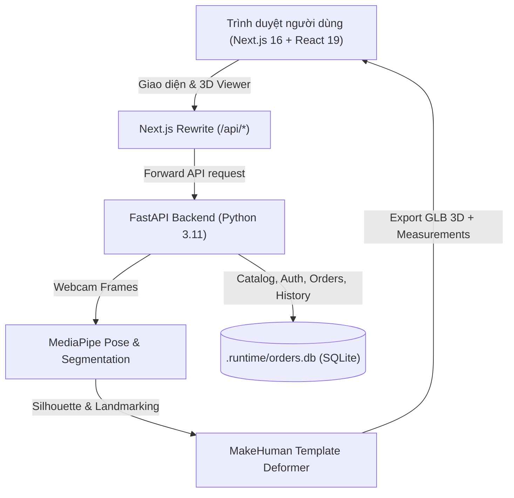

# MORPH Studio — Nền tảng Thời trang & Ước lượng Hình thể 3D

> **Tài liệu bàn giao cốt lõi**:
> - [CAMERA_FLOW_HANDOFF.md](CAMERA_FLOW_HANDOFF.md) — Quy trình chụp camera chuẩn: chính diện → xoay 90° chụp nghiêng, đếm ngược tự động.
> - [UPPER_BODY_HANDOFF.md](UPPER_BODY_HANDOFF.md) — Chế độ webcam thân trên mặc định, tùy chọn toàn thân, workspace đo 3D.
> - [COMMERCE_HANDOFF.md](COMMERCE_HANDOFF.md) — Phạm vi cửa hàng demo local, catalog 160 sản phẩm, giỏ hàng, checkout.
> - [AGENTS.md](AGENTS.md) — Nguyên tắc và ranh giới kỹ thuật bắt buộc cho toàn bộ agent và developer.
> - [HUONG_DAN_CHAY.md](HUONG_DAN_CHAY.md) — Hướng dẫn chi tiết môi trường Python venv, Node.js và debug F5.

---

## 1. Giới thiệu tổng quan

**MORPH Studio** là ứng dụng web thương mại điện tử thời trang tối giản tích hợp công nghệ thị giác máy tính và đồ họa 3D:
- **Cửa hàng thời trang hiện đại**: 160 sản phẩm thời trang cao cấp thuộc 5 danh mục (Áo thun, Sơ mi, Áo khoác, Quần, Váy/Đầm). 100% sử dụng ảnh chụp studio thật chất lượng cao (tỷ lệ 3:4 chuẩn packshot, kèm ảnh zoom phóng to chi tiết chất liệu/cổ áo cắt từ chính trang phục đó).
- **Bộ máy ước lượng số đo & đề xuất size**: Chụp 2 góc qua webcam (chính diện & nghiêng), bóc tách silhouette bằng MediaPipe, ước lượng tiết diện cơ thể elip và biến dạng lưới MakeHuman template xuất file 3D GLB.
- **Trải nghiệm đo 3D tương tác**: BodyViewer WebGL cho phép xoay 360°, hiển thị đường thước đo ngực/eo/mông trực quan trên thân người mẫu, so sánh độ vừa vặn với bảng size chuẩn của từng món đồ.
- **Thương mại khép kín nội bộ**: Giỏ hàng tương tác, Wishlist Drawer với tính năng chọn biến thể màu/size trực tiếp, quy trình Checkout kiểm tra tồn kho và tạo đơn hàng cục bộ qua SQLite transaction an toàn.

---

## 2. Kiến trúc hệ thống



### Frontend (`frontend/`)
- **Framework**: Next.js 16 (App Router), React 19, TypeScript.
- **Styling & UI**: CSS scoped/modular phong cách Modern Studio Luxury (Warm Ivory `#f9f6f0`, Charcoal `#1f2220`, Champagne Gold `#c5a880`). Hỗ trợ Dark Mode, responsive hoàn hảo trên Mobile (360px..430px), Tablet (768px..1100px) và Desktop.
- **Đồ họa 3D**: Three.js, `@react-three/fiber`, `@react-three/drei` render mô hình avatar GLB với điều khiển camera, bật/tắt lưới wireframe, hiển thị thước đo vòng 3D.
- **Accessibility & UX**: WAI-ARIA chuẩn mực (`role="dialog"`, `aria-invalid`, `aria-describedby`, focus trap, scroll lock, điều hướng bằng phím mũi tên).

### Backend (`backend/`)
- **Framework**: FastAPI, Uvicorn, Pydantic v2.
- **Thị giác máy tính**: MediaPipe Pose/Segmentation chạy CPU tối ưu, không phụ thuộc GPU rời hay dịch vụ cloud tính phí.
- **Cơ sở dữ liệu**: SQLite (`.runtime/orders.db`) với hệ thống migration tự động (`app/db.py`), kết nối transaction an toàn (`BEGIN IMMEDIATE;`).
- **Xác thực**: JWT Bearer token kết hợp cookie HTTP-only, mã hóa mật khẩu salted pbkdf2_sha256.

---

## 3. Các phân hệ chức năng

### A. Cửa hàng & Danh mục sản phẩm (`/`, `/products/[slug]`)
- **160 sản phẩm thời trang**: Chia đều 32 sản phẩm cho 5 danh mục:
  - Áo thun (`ao-thun`)
  - Sơ mi (`so-mi`)
  - Áo khoác (`ao-khoac`)
  - Quần (`quan`)
  - Váy & Đầm (`vay`)
- **Chuẩn hóa media v2**: 320 ảnh packshot studio thời trang thật (160 ảnh toàn thân + 160 ảnh zoom chi tiết chất liệu), kích thước chuẩn 1200×1600px (tỷ lệ 3:4 portrait), ghi nhận minh bạch nguồn và giấy phép thương mại miễn phí tại `backend/scripts/catalog_asset_manifest_v2.json`.
- **Bộ lọc thông minh**: Lọc danh mục, tìm kiếm theo tên/mô tả, lọc khoảng giá (hỗ trợ cả preset `<500k`, `500k-1m`, `>1m` và slider tuỳ chỉnh), lọc theo nhóm màu không dấu, lọc theo size được sắp xếp chuẩn công nghiệp (`XS` đến `3XL`, quần từ `28` đến `34`).

### B. Giỏ hàng, Wishlist & Đặt hàng (`/cart`, `/checkout`, `/orders/[id]`)
- **Cart Page & Cart Drawer**: Tăng/giảm số lượng, xóa item, đổi màu sắc và kích thước trực tiếp dựa trên tồn kho thực tế của sản phẩm.
- **Wishlist Drawer**: Lưu món đồ yêu thích, hiển thị trạng thái còn hàng/hết hàng, trực tiếp chọn màu/size và đẩy nhanh vào checkout.
- **Quy trình Checkout**: Form nhập địa chỉ giao hàng với validation inline thời gian thực; tính phí vận chuyển tự động (miễn phí từ 500.000₫); trừ tồn kho bằng transaction bảo đảm không bán vượt số lượng; sinh mã đơn hàng độc nhất `ORD-xxxx`.

### C. Quét cơ thể & Đo size thông minh (`/scan`)
- **Webcam hướng dẫn**: Backend nhận diện khung hình và hướng dẫn người dùng căn chỉnh:
  - Khung 1: Chụp chính diện (Front view).
  - Khung 2: Xoay 90° chụp nghiêng (Side view).
  - Hỗ trợ đếm ngược 3 giây khi tư thế đạt chuẩn, hoặc chụp bấm nút thủ công.
- **Chế độ chụp thích ứng**: Thân trên (Upper Body) mặc định cho áo/sơ mi; Toàn thân (Full Body) khi cần đo chiều dài chân, vòng mông cho quần/váy.
- **Trực quan hóa số đo 3D**: Xuất file 3D `.glb` với thước đo gắn trực tiếp trên mesh avatar (vòng ngực, vòng eo, vòng mông).
- **Tư vấn size**: Đối chiếu số đo ước lượng với bảng thông số thực tế của sản phẩm, đưa ra khuyến nghị size phù hợp nhất kèm cảnh báo mức độ rộng/ôm.

### D. Tài khoản & Lịch sử hình thể (`/account`, `/login`, `/register`)
- **Xác thực an toàn**: Đăng nhập/Đăng ký với thông báo lỗi inline trực tiếp dưới từng ô nhập liệu, tự động focus ô lỗi đầu tiên.
- **Lưu trữ scan**: Tự động hoặc chủ động lưu lại các phiên scan hình thể vào hồ sơ người dùng để theo dõi sự thay đổi vóc dáng hoặc tái sử dụng khi mua sắm.

---

## 4. Hướng dẫn khởi chạy nhanh

### Yêu cầu tiên quyết
- **Hệ điều hành**: Windows 10/11 (hoặc Linux/macOS tương đương).
- **Python**: Python 3.11 (được thiết lập sẵn tại `.runtime/python` hoặc venv tại `backend/.venv`).
- **Node.js**: Phiên bản 18+ (khuyên dùng Node.js 20 hoặc 22 LTS).

### Khởi động dự án (Khuyên dùng)

Mở thư mục `D:\MORPH-AI` bằng PowerShell hoặc Terminal:

#### Cách 1: Chạy từng dịch vụ bằng PowerShell riêng biệt

**Terminal 1 — Khởi động Backend (Port 8000)**:
```powershell
powershell -NoProfile -ExecutionPolicy Bypass -File .\start-backend.ps1
```
*Backend Swagger API Docs sẵn sàng tại*: `http://127.0.0.1:8000/docs`

**Terminal 2 — Khởi động Frontend (Port 3000)**:
```powershell
powershell -NoProfile -ExecutionPolicy Bypass -File .\start-frontend.ps1
```
*Giao diện Storefront sẵn sàng tại*: `http://127.0.0.1:3000`

#### Cách 2: Sử dụng script Batch một chạm
- Khởi động cả 2 server: Click đúp `start-all.bat` (hoặc chạy trong cmd: `start-all.bat`).
- Tắt toàn bộ server: Click đúp `stop-all.bat`.

---

## 5. Kiểm thử hệ thống (Testing & Verification)

Hệ thống được trang bị bộ kiểm thử tự động toàn diện:

### 1. Kiểm thử Backend (Pytest Suite)
Chạy toàn bộ 89 ca kiểm thử đơn vị & tích hợp (API, Auth, Catalog, Cart, Orders, Measurements, Sizing):
```powershell
powershell -NoProfile -ExecutionPolicy Bypass -File .\test-backend.ps1
```
*Hoặc chạy trực tiếp với Python venv*:
```powershell
$env:PATHEXT = '.COM;.EXE;.BAT;.CMD'; backend/.venv/Scripts/python.exe -m pytest backend/tests/ -v
```
*(Kết quả yêu cầu: 89/89 tests PASSED)*.

### 2. Kiểm thử Frontend (TypeScript Typecheck)
Xác thực tính toàn vẹn kiểu dữ liệu của toàn bộ mã nguồn Next.js / React:
```powershell
npm --prefix frontend run typecheck
```
*(Kết quả yêu cầu: 0 errors)*.

### 3. Kiểm tra tính toàn vẹn Catalog Media
Kiểm tra số lượng ảnh studio v2, đường dẫn hợp lệ và không có ảnh lỗi:
```powershell
$env:PATHEXT = '.COM;.EXE;.BAT;.CMD'; backend/.venv/Scripts/python.exe backend/scripts/inspect_catalog_status.py
```
*(Kết quả yêu cầu: 160/160 sản phẩm có ảnh v2, 320 ảnh tồn tại, 0 ảnh thiếu)*.

---

## 6. Cấu trúc thư mục

```
D:\MORPH-AI
├── backend/
│   ├── app/
│   │   ├── main.py                # FastAPI entry point & lifespan
│   │   ├── catalog.py             # Catalog API routes & filters
│   │   ├── catalog_seed_data.py   # Seed catalog definition (160 products)
│   │   ├── db.py                  # SQLite migrations & queries
│   │   ├── auth.py                # JWT authentication & user accounts
│   │   ├── orders.py              # Cart checkout & order transactions
│   │   ├── history.py             # Body profile & scan history persistence
│   │   ├── reconstruction.py      # Mesh fitting & GLB generation
│   │   ├── sizing.py              # Size recommendation logic
│   │   └── images.py              # Photo preprocessing & validation
│   ├── scripts/
│   │   ├── catalog_asset_manifest_v2.json # Master asset provenance manifest
│   │   ├── import_catalog_media_v2.py    # Idempotent DB media importer
│   │   └── inspect_catalog_status.py     # Catalog image status inspector
│   └── tests/                     # 89 automated pytest test suites
│
├── frontend/
│   ├── app/                       # Next.js App Router (Storefront, PDP, Cart, Checkout, Scan, Auth)
│   ├── components/
│   │   ├── shop/                  # ProductCard, ProductDetail, CustomSelect, Popups, Drawers
│   │   ├── BodyViewer.tsx         # Three.js 3D WebGL Avatar & tape measurements
│   │   └── GuidedCamera.tsx       # Live webcam pose guide & countdown
│   ├── lib/                       # API clients, CartContext, ScanContext, helpers
│   └── public/
│       └── products/v2/           # 320 high-resolution studio packshot photos
│
├── .runtime/                      # Local SQLite orders.db and cached runtimes (gitignored)
├── AGENTS.md                      # Canonical development rules and guardrails
├── CAMERA_FLOW_HANDOFF.md         # Camera capture architecture spec
├── COMMERCE_HANDOFF.md            # Commerce storefront specification
├── UPPER_BODY_HANDOFF.md          # 3D measurement & scan specification
└── README.md                      # Tài liệu tổng quan hệ thống này
```

---

## 7. Ranh giới kỹ thuật & Cam kết trung thực

Theo tôn chỉ của MORPH Studio và hướng dẫn tại `AGENTS.md`:
1. **Bản chất công nghệ**: Bộ máy ước lượng sử dụng MediaPipe (pose/segmentation) + biến dạng MakeHuman template trên CPU. Hệ thống **không** sử dụng SAM/MHR hay các mô hình quét laser chuyên dụng. Số đo cơ thể mang tính chất tham khảo trực quan hỗ trợ chọn cỡ quần áo, không thay thế phép đo may đo chuyên nghiệp.
2. **Bảo mật dữ liệu**: Ứng dụng không lưu giữ khung hình webcam cá nhân lên máy chủ sau khi xử lý. File 3D `.glb` được cấp phát với thời hạn lưu tạm thời và tự động dọn dẹp theo chu kỳ (`cleanup janitor`).
3. **Phạm vi thương mại**: Hiện tại hệ thống phục vụ mục đích demo thương mại điện tử cục bộ, không đấu nối cổng thanh toán trực tuyến của bên thứ ba hay lưu trữ thẻ ngân hàng.
