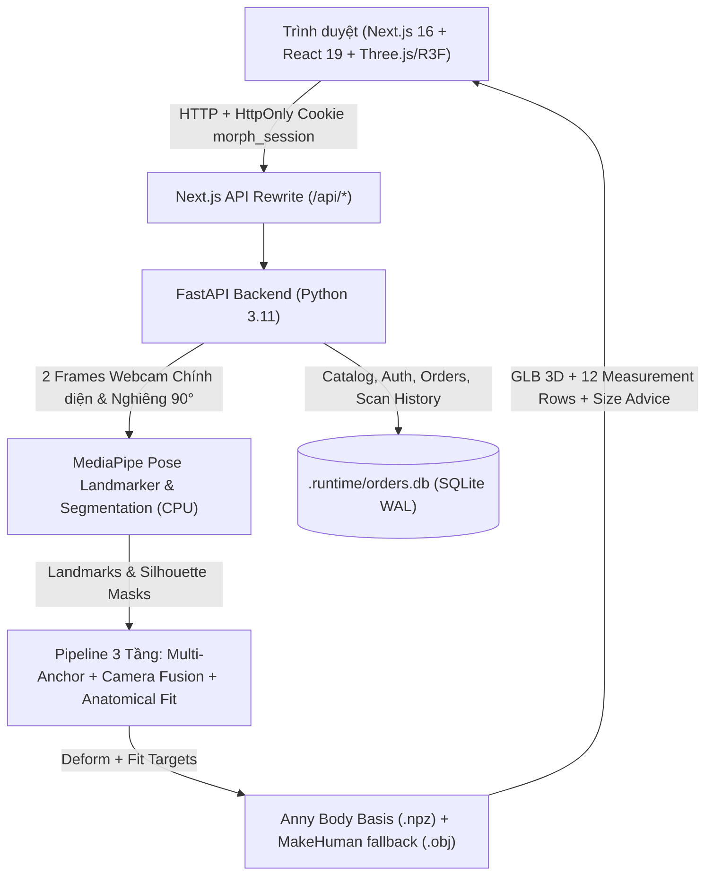

# MORPH Studio — Kiến Trúc Hệ Thống Toàn Diện (`docs/ARCHITECTURE.md`)

> **Nguồn mã chuẩn (Canonical Source)**: `D:\MORPH-AI`  
> Giữ `frontend/` và `backend/` tách biệt hoàn toàn. Không chỉnh sửa bản sao cũ trong `Documents/Codex`.

---

## 1. Tổng Quan Kiến Trúc

**MORPH Studio** là ứng dụng thương mại điện tử thời trang nội bộ (local demo) tích hợp phòng thử đồ & ước lượng số đo 3D từ 2 góc chụp webcam:

---

## 2. Phân Tách Frontend & Backend

| Thành phần | Đường dẫn | Công nghệ & Vai trò |
| :--- | :--- | :--- |
| **Frontend** | [`frontend/`](file:///d:/MORPH-AI/frontend) | Next.js 16 (App Router), React 19, TypeScript, Three.js / `@react-three/fiber` / `@react-three/drei`. Giao diện cửa hàng Warm Ivory (`#FAF7F0`) & Champagne Gold (`#C6A15B`), kèm workspace kết quả đo 3D nền tối chuyên dụng. |
| **Backend** | [`backend/`](file:///d:/MORPH-AI/backend) | FastAPI, Uvicorn, Pydantic v2, MediaPipe Pose Landmarker (CPU), NumPy/SciPy (`PchipInterpolator`, `ellipe`), Trimesh, Pillow, SQLite3. |
| **Python Runtime** | `.runtime/python/python.exe` & `backend/.venv/Scripts/python.exe` | Python 3.11.17 cục bộ trong project. Không sử dụng alias Python của Windows Store. |
| **Cơ sở dữ liệu** | `.runtime/orders.db` | SQLite ở chế độ `WAL` (`PRAGMA foreign_keys = ON`), quản lý qua hệ thống migration tự động tại [`backend/app/db.py`](file:///d:/MORPH-AI/backend/app/db.py). |

---

## 3. Các Phân Hệ Chức Năng Cốt Lõi

### 3.1. Luồng Camera-Only Hai Góc Chụp (`CaptureSession` & `FitExperience`)
- **Nguyên tắc bắt buộc**: **Camera-only** — không có nút tải ảnh lên (upload file chooser / drag-drop) và không hiển thị hình nộm mẫu (sample mannequin) trước khi quét.
- **Quy trình 1 phiên `getUserMedia` duy nhất** ([`CaptureSession.tsx`](file:///d:/MORPH-AI/frontend/components/shop/CaptureSession.tsx), [`FitExperience.tsx`](file:///d:/MORPH-AI/frontend/components/shop/FitExperience.tsx)):
  1. Người dùng nhập chiều cao (`100–230 cm`), chọn chế độ quét và đồng ý xử lý hình ảnh (consent).
  2. Bấm **Mở camera & bắt đầu** $\rightarrow$ **Bắt đầu quét**.
  3. **Góc 1 (Chính diện)**: AI kiểm tra tư thế liên tục qua `POST /api/capture-check` (timeout 5s, nghỉ 500ms, yêu cầu khung hình ổn định) $\rightarrow$ đếm ngược 5 giây $\rightarrow$ tự chụp frame chính diện.
  4. **Chuyển góc**: Giữ nguyên `MediaStream` đang mở, hiển thị hướng dẫn xoay người 90° trong 4 giây.
  5. **Góc 2 (Nghiêng 90°)**: AI xác nhận góc nghiêng đạt chuẩn $\rightarrow$ đếm ngược 5 giây $\rightarrow$ tự chụp frame nghiêng, đóng stream camera và tự động gửi 2 frame lên `POST /api/scans`.
- **Chế độ chụp thích ứng (`upper_body` vs `full_body`)**:
  - **Mặc định `upper_body` (Webcam · Thân trên)**: Áp dụng cho áo thun, sơ mi, áo khoác. Chụp từ đỉnh đầu đến cạp quần/hông trên; không yêu cầu thấy đầu gối hay bàn chân.
  - **Tự động ưu tiên `full_body` (Toàn thân)**: Khi mở từ trang sản phẩm thuộc danh mục Quần (`cat-quan`), Váy/Đầm (`cat-vay`), hoặc bảng size có `garment: "bottom" | "dress"`, `FitExperience` tự động chọn `full_body`, hiển thị thẻ hướng dẫn đặt thiết bị cách `2m–2.5m`, và hiện cảnh báo màu hổ phách nếu người dùng chuyển sang `upper_body`.
- **Bố cục Camera & Mở rộng toàn khung hình**:
  - Desktop chia 2 cột (`minmax(0, 1fr) 300px`): khung video bên trái không bị banner che khuất vùng đầu–vai–eo–cạp quần; cột điều khiển & hướng dẫn bên phải.
  - Hỗ trợ nút mở rộng (`Maximize2` / `Minimize2`) toàn viewport (`100vw × 100dvh`) và nhấn `Escape` để thu nhỏ mà không ngắt `MediaStream` hay hủy đếm ngược.
  - Quản lý tài nguyên chặt chẽ: Đổi camera, đóng modal hoặc hủy phiên lập tức dừng mọi `MediaStreamTrack`, hủy timer và abort request đang chờ.

### 3.2. Trình Xem 3D & Workspace Kết Quả (`BodyViewer` & `ScanResult`)
- **[`ScanResult.tsx`](file:///d:/MORPH-AI/frontend/components/shop/ScanResult.tsx)**:
  - Đặt khối **Gợi ý Size** lên đầu màn hình kết quả với nút CTA **"Áp dụng size [X] →"** để gán trực tiếp size vào sản phẩm đang xem.
  - Nếu thiếu số đo vòng mông cho quần/váy (do chụp `upper_body`), hiển thị chẩn đoán rõ ràng kèm nút **"Quét lại toàn thân"** và **"Xem bảng size & chọn thủ công"**.
  - Hiển thị danh sách 12 dòng thông số từ [`backend/app/report.py`](file:///d:/MORPH-AI/backend/app/report.py) kèm nhãn nguồn minh bạch (`user_input`, `photo_estimate`, `photo_with_prior`, `template_model`, `unavailable`), hỗ trợ chuyển đổi `cm / in`, tải file `.glb`, JSON số đo và chụp ảnh màn hình `.png`.
- **[`BodyViewer.tsx`](file:///d:/MORPH-AI/frontend/components/BodyViewer.tsx)**:
  - Hiển thị mô hình `.glb` với 3 chế độ dựng hình (Khối đặc `solid`, Điểm 3D `points`, Khung lưới `wireframe`), 4 góc camera cài sẵn (`Trước`, `Nghiêng`, `Sau`, `3/4`), và vòng đo 3D thật cắt từ mặt phẳng lưới.
  - Nhãn DOM được đặt bên ngoài Canvas R3F để tránh lỗi `removeChild` của Drei Html portal trên React 19 khi unmount/xóa phiên.

### 3.3. Cửa Hàng Thời Trang Đa Sản Phẩm (`Catalog` & `Storefront`)
- **Cơ sở dữ liệu Catalog SQLite** ([`backend/app/catalog.py`](file:///d:/MORPH-AI/backend/app/catalog.py), [`backend/app/seed.py`](file:///d:/MORPH-AI/backend/app/seed.py), [`backend/app/catalog_seed_data.py`](file:///d:/MORPH-AI/backend/app/catalog_seed_data.py)):
  - **163 sản phẩm** trên 5 danh mục: Áo thun (`ao-thun`, 35 sản phẩm — gồm 3 mẫu có số đo may công bố), Sơ mi (`so-mi`), Áo khoác (`ao-khoac`), Quần (`quan`), Váy & Đầm (`vay`) — mỗi danh mục còn lại 32 sản phẩm.
  - **1.691 biến thể SKU** (`product_variants`) theo màu sắc × kích cỡ × tồn kho thực tế (`stock`).
  - **29 bảng size** (`size_charts`) tính theo số đo cơ thể (`body_cm`), 2 bảng kèm `garment_specs` (số đo may trải phẳng).
  - **320 ảnh sản phẩm studio v2** tại `frontend/public/products/v2/` (tỷ lệ 3:4 `1200×1600px`, gồm ảnh chính và ảnh phóng to chi tiết chất liệu, quản lý tại `backend/scripts/catalog_asset_manifest_v2.json`).
- **Trải nghiệm tìm kiếm & lọc** ([`StorefrontHome.tsx`](file:///d:/MORPH-AI/frontend/components/shop/StorefrontHome.tsx), [`ProductFilter.tsx`](file:///d:/MORPH-AI/frontend/components/shop/ProductFilter.tsx)):
  - Phân trang 24 sản phẩm/trang đồng bộ hai chiều với URL query params (`?page=...&category=...&sort=...`).
  - Lọc theo danh mục, từ khóa, khoảng giá, màu sắc, kích cỡ; sắp xếp theo nổi bật, giá tăng/giảm, mới nhất.

### 3.4. Hệ Thống Popup, Modal, Drawer & Accessibility
- **[`Modal.tsx`](file:///d:/MORPH-AI/frontend/components/shop/Modal.tsx) & [`useDrawerA11y.ts`](file:///d:/MORPH-AI/frontend/lib/useDrawerA11y.ts)**:
  - Trên Desktop (`>= 768px`): Hiển thị dạng Modal cân giữa màn hình (`border-radius: 24px`).
  - Trên Mobile (`< 768px`): Tự động chuyển thành **Bottom Sheet** bám đáy màn hình với thanh kéo `.sheet-handle-bar`.
  - Quản lý `document.body.style.overflow` an toàn qua bộ đếm toàn cục, bẫy focus (`Tab` / `Shift+Tab`) và trả focus về đúng phần tử kích hoạt khi đóng.
- **[`CustomSelect.tsx`](file:///d:/MORPH-AI/frontend/components/shop/CustomSelect.tsx) & [`ProductPickerPopover.tsx`](file:///d:/MORPH-AI/frontend/components/shop/ProductPickerPopover.tsx)**:
  - Tự động đo `getBoundingClientRect()` để lật lên trên (`.is-flipped-up`) hoặc căn phải (`.is-align-right`) chống tràn mép viewport.
  - Trên mobile `/scan`, `ProductPickerPopover` render qua `createPortal(..., document.body)` để thoát khỏi khối `backdrop-filter`.
  - Khi `CustomSelect` đang mở và người dùng nhấn `Escape`, sự kiện được chặn ở pha capture (`stopPropagation()` + `stopImmediatePropagation()`) để chỉ đóng dropdown con mà **không đóng nhầm Drawer/Modal cha** (như `WishlistDrawer`).

### 3.5. Giỏ Hàng, Wishlist & Đặt Hàng Nguyên Tử (`Cart`, `Wishlist`, `Checkout`, `Orders`)
- **Wishlist ([`WishlistDrawer.tsx`](file:///d:/MORPH-AI/frontend/components/shop/WishlistDrawer.tsx))**:
  - Cho phép chọn màu sắc, kích cỡ và số lượng từ biến thể thực tế trong SQLite.
  - Sử dụng `syncItemToCart` kết hợp `dispatchedRef` và cập nhật số lượng tuyệt đối `updateQuantity(productId, color, size, quantity, true)` trong [`CartContext.tsx`](file:///d:/MORPH-AI/frontend/lib/CartContext.tsx), đảm bảo khi bấm **"Thêm vào giỏ"** rồi bấm **"Tiếp tục đặt hàng"** số lượng trong giỏ **không bao giờ bị cộng đôi**.
- **Giỏ hàng ([`frontend/app/cart/page.tsx`](file:///d:/MORPH-AI/frontend/app/cart/page.tsx))**:
  - Hỗ trợ đổi màu/size trực tiếp trong giỏ, điều chỉnh số lượng `1..10`, thanh tiến trình miễn phí vận chuyển từ `500.000₫` (phí chuẩn `30.000₫`), và nút Xóa kèm **Undo Toast 7 giây**.
- **Đặt hàng & Chống gian lận giá ([`frontend/app/checkout/page.tsx`](file:///d:/MORPH-AI/frontend/app/checkout/page.tsx), [`backend/app/orders.py`](file:///d:/MORPH-AI/backend/app/orders.py))**:
  - Kiểm tra định dạng số điện thoại Việt Nam đồng bộ giữa FE và BE (chuẩn hóa `+84`/`84` về `0`, gồm 9–11 chữ số) và tự động focus vào ô lỗi đầu tiên ngay lần submit đầu.
  - Đơn giá luôn được truy vấn trực tiếp từ bảng `products` trong SQLite, bỏ qua mọi giá do client gửi lên.
  - Đặt hàng sử dụng giao dịch nguyên tử **`BEGIN IMMEDIATE;`** để kiểm tra và trừ `stock` trong `product_variants` (hết hàng sẽ rollback hoàn toàn và trả về HTTP `400` tiếng Việt).
  - Chống đặt trùng đơn bằng khóa **`Idempotency-Key`** (trả về đơn đã tạo nếu cùng payload, hoặc `409 Conflict` nếu khác payload).
  - Sinh mã đơn `MPH-YYYYMMDD-XXXX` và `token = secrets.token_urlsafe(24)` để tra cứu an toàn tại `/orders/[id]?token=...`.

### 3.6. Xác Thực Phiên (`Auth`) & Hồ Sơ Hình Thể (`Body Profile`)
- **Cơ chế Xác thực Stateful Session ([`backend/app/auth.py`](file:///d:/MORPH-AI/backend/app/auth.py), [`frontend/lib/AuthContext.tsx`](file:///d:/MORPH-AI/frontend/lib/AuthContext.tsx))**:
  - Sử dụng **Opaque Session Token** (`secrets.token_urlsafe(32)`) lưu trong cookie `HttpOnly`, `SameSite=lax`, thời hạn 30 ngày (`morph_session`) — **không sử dụng JWT** và không lưu token xác thực trong `localStorage`.
  - Trong SQLite (`user_sessions`), token được băm một chiều bằng `SHA-256` trước khi lưu. Mật khẩu người dùng được băm bằng `PBKDF2-HMAC-SHA256` (`200.000` vòng lặp) kèm salt ngẫu nhiên và so sánh qua `hmac.compare_digest`.
  - Chống vét cạn mật khẩu (Rate Limiting): Sai quá 5 lần liên tiếp trong 5 phút trên cùng IP + email sẽ khóa tạm thời 5 phút (HTTP `429 Too Many Requests`); đăng nhập đúng sẽ xóa bộ đếm.
  - Vệ sinh khi đăng xuất (`Logout Hygiene`): Xóa session trong DB, xóa cookie `morph_session`, và dọn sạch `morph_scan_guest_token_*` cùng `morph_saved_scans_map` trong `sessionStorage`.
- **Bảo mật Phiên Scan Khách & Lưu Hồ Sơ ([`backend/app/main.py`](file:///d:/MORPH-AI/backend/app/main.py), [`backend/app/history.py`](file:///d:/MORPH-AI/backend/app/history.py))**:
  - Mỗi phiên scan khách (`user_id is None`) sinh một `guest_token = secrets.token_urlsafe(24)`.
  - Hàm `check_scan_access` bắt buộc mọi truy vấn `GET`/`POST`/`DELETE /api/scans/{id}*` của phiên khách phải gửi kèm `guest_token` hợp lệ (qua header `X-Guest-Token` hoặc query `?guest_token=`) khớp qua `secrets.compare_digest`; nếu thiếu hoặc sai sẽ trả về HTTP `403 Forbidden`.
  - Khi người dùng đăng nhập và gọi `POST /api/user/scans/save`, hệ thống kiểm tra `guest_token` bằng `secrets.compare_digest` và chuyển quyền sở hữu scan sang tài khoản một cách idempotent.
- **Biểu Đồ Hình Thể & So Sánh Scan ([`BodyChart.tsx`](file:///d:/MORPH-AI/frontend/components/shop/BodyChart.tsx), [`ScanCompareModal.tsx`](file:///d:/MORPH-AI/frontend/components/shop/ScanCompareModal.tsx))**:
  - Biểu đồ SVG thuần tính tọa độ trục X tuyến tính theo thời gian thực (`captured_at`), xử lý an toàn trường hợp `timeSpan <= 0` (hiển thị chính giữa, không lỗi `NaN`).
  - Các điểm scan cách nhau `< 16px` được gom thành **Cluster Badge** có popover xem từng lần quét.
  - Các giá trị `null`, `<= 0` hoặc có nguồn `template_model` (như `hip_cm` trong chế độ `upper_body`) tự động ngắt đoạn đường biểu diễn (`M ... L ...`), tuyệt đối không nối về `0` hay tạo xu hướng giả.
  - Công cụ so sánh 2 lần scan đưa ra chênh lệch toán học trung tính (`+1.2 cm`, `-0.8 cm`) và cảnh báo khi khác chế độ chụp, không phán đoán y khoa hay sức khỏe.
